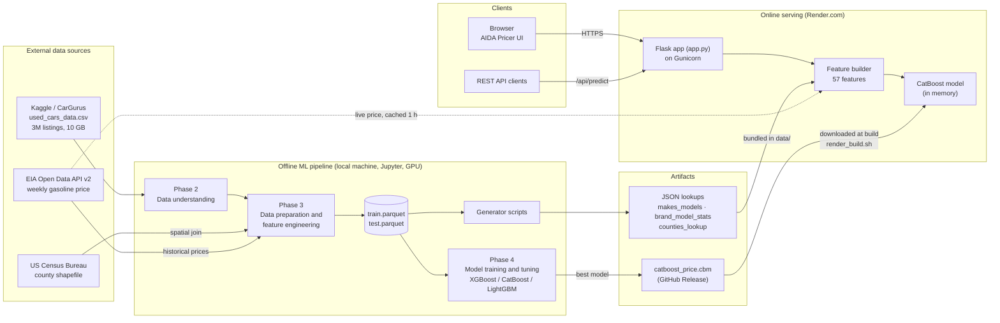
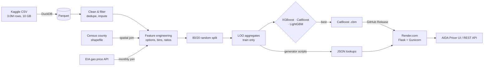

# AIDA Pricer — Used Car Price Prediction

> A machine learning model and web app that estimates the market price of a used car in the United States, from its specifications, equipment and county-level sales location.


**Live demo:** <https://aida-project.onrender.com/> (free tier: the first request after ~15 minutes of inactivity can take about 30 seconds while the server wakes up)

---

## Table of Contents

- [Overview](#overview)
- [Features](#features)
- [Tech Stack](#tech-stack)
- [Getting Started](#getting-started)
- [Usage](#usage)
- [Project Structure](#project-structure)
- [Architecture & Methodology](#architecture--methodology)
- [Results](#results)
- [Limitations & Future Improvements](#limitations--future-improvements)
- [Authors](#authors)
- [License & Data Usage](#license--data-usage)

---

## Overview

### Problem

Used car dealerships need to price vehicles correctly both when **buying** them in and when **selling** them on. Overpaying at purchase or under-pricing at sale eats directly into margin. Prices depend on many interacting factors, such as make, model, age, mileage, powertrain, equipment and regional demand, which makes consistent manual pricing hard.

### Purpose

This project was carried out as a team project in an AI / Data Analytics course, following the **CRISP-DM** process model (Business Understanding → Data Understanding → Data Preparation → Modeling → Evaluation → Deployment). The imaginary customer is a **used car dealership**. Consumers comparing an asking price to the market are a secondary audience.

### Solution

- Processed a **~3 million row** dataset of US used car listings (CarGurus, scraped in September 2020) on ordinary home computers, using Polars, DuckDB and Parquet.
- Engineered **57 features**, including equipment flags, county-level geo features joined from US Census shapefiles, weekly gasoline prices from the U.S. Energy Information Administration (EIA) API, and leakage-safe market aggregates.
- Trained and compared **XGBoost, CatBoost and LightGBM** regressors. **CatBoost** came out best, with **R² = 0.961 and MAE = $2,136** on a 541k-row hold-out test set.
- Deployed the model as **AIDA Pricer**, a Flask web app on Render.com that returns a price estimate with a confidence band.

> **Scope change:** the original plan also included predicting *time on market* (`daysonmarket`). During evaluation the team found that the variable only records how long a car had been listed **when the data was scraped**. Every car in the dataset was still unsold, so the data contains no real sale times. The time-on-market model was therefore dropped and the project focused on price (see [Phase 5](docs/Phase%205/phase_5_results.ipynb)).

---

## Features

**Machine learning pipeline**

- Memory-efficient handling of a 10 GB CSV: chunked loading, dtype downcasting and lazy Polars/DuckDB queries over Parquet.
- Duplicate detection (113k duplicate listings removed) and filtering of implausible values.
- Imputation of missing values from similar cars, falling back from make + model + year to make + model to make.
- **22 binary equipment flags** parsed from free-text `major_options` (leather, sunroof, navigation, CarPlay, adaptive cruise and others).
- **Geo-enrichment:** each dealer's latitude and longitude is spatially joined to one of **2,217 US counties** (`GEOID`, `STATEFP`).
- **Macroeconomic feature:** weekly US regular gasoline price from the EIA API v2, joined by listing month (set to 0 for electric vehicles).
- **Leakage-safe target aggregates:** leave-one-out (LOO) `brand_model_avg_price` and `county_avg_price` on the training set, with training-set-only aggregates joined to the test set.
- Comparison of three gradient boosting models, hyperparameter search with Optuna, manual tuning, 5-fold cross-validation, ablation tests and residual analysis.

**AIDA Pricer web app**

- A five-step form: make & model (cascading dropdowns) → basic info → technical specs → state & county → equipment.
- Live gasoline price fetched from the EIA API and cached for one hour.
- A result card showing the estimated price, a ±MAE range, the model's R² and a warning for cars above $75k.
- A JSON REST API and a `/api/health` endpoint for monitoring.
- The model (~196 MB) is downloaded from a GitHub Release at build time, so it never has to be committed to Git.

---

## Tech Stack

| Area | Tools |
|---|---|
| **Language** | Python 3 |
| **Data processing** | Polars, pandas, NumPy, DuckDB, PyArrow / Parquet |
| **Geospatial** | GeoPandas, Shapely, US Census cartographic boundary files (`cb_2023_us_county_500k`) |
| **Machine learning** | CatBoost, XGBoost, LightGBM, scikit-learn, Optuna |
| **Visualization** | Matplotlib, Seaborn |
| **External data / APIs** | EIA Open Data API v2 (weekly retail gasoline prices) |
| **Web backend** | Flask 3, Gunicorn, python-dotenv, Requests |
| **Frontend** | HTML5, CSS3, vanilla JavaScript (Jinja2 templates) |
| **Deployment** | Render.com (Web Service with CI/CD from GitHub), GitHub Releases for model hosting |
| **Development** | Jupyter Notebook, VS Code, Git, NVIDIA GPU (CUDA) for training |

---

## Getting Started

### Prerequisites

- **Python 3.10 – 3.12** (the deployment pins NumPy 1.26, which does not support Python 3.13)
- **~16 GB RAM** recommended for the full-data notebooks. Training on the full dataset is much faster with an **NVIDIA GPU**, but it also runs on CPU.
- A free **EIA API key**: <https://www.eia.gov/opendata/register.php>
- The **dataset** (≈10 GB CSV): [US Used Cars Dataset on Kaggle](https://www.kaggle.com/datasets/ananaymital/us-used-cars-dataset) (`used_cars_data.csv`)
- The **US county shapefile**: `cb_2023_us_county_500k`, from the [US Census Bureau](https://www.census.gov/geographies/mapping-files/time-series/geo/cartographic-boundary.html). An unzipped copy is included in [cb_2023_us_county_500k/](cb_2023_us_county_500k/).

### Installation

```bash
# 1. Clone the repository
git clone https://github.com/joonapankkone/used-car-prediction.git
cd used-car-prediction

# 2. Create and activate a virtual environment
python -m venv .venv
source .venv/bin/activate          # Windows: .venv\Scripts\activate

# 3. Install the dependencies for the analysis notebooks
pip install polars pandas numpy duckdb pyarrow geopandas shapely \
            matplotlib seaborn scikit-learn catboost xgboost lightgbm \
            optuna python-dotenv requests joblib psutil jupyter
```

### Configuration

Data files are deliberately kept **out of Git** (`data/`, `archive/` and `processed/` are listed in `.gitignore`). Each developer points the code at their own local data folder through a `.env` file in the project root:

```dotenv
# .env  (never commit this file)
DATA_PATH=/absolute/path/to/your/data/folder
EIA_API_KEY=your_eia_api_key
```

Place the raw files in `DATA_PATH`:

```text
<DATA_PATH>/
├── used_cars_data.csv              # Kaggle dataset (converted to Parquet automatically on first run)
└── cb_2023_us_county_500k.zip      # Census county shapefile (zip the included folder or download it)
```

---

## Usage

### 1. Reproduce the ML pipeline

Run the notebooks in order. Each phase writes intermediate files into `DATA_PATH`.

| Step | Notebook | What it does | Output |
|---|---|---|---|
| 1 | [Phase 2 – Data Understanding](docs/Phase%202/phase_2_results.ipynb) | EDA, data quality, duplicates, missing values, distributions | Summary CSVs in `docs/Phase 2/` |
| 2 | [Phase 3 – Data Preparation](docs/Phase%203/phase_3_results.ipynb) | Cleaning, imputation, feature engineering, geo join, EIA join, train/test split, LOO aggregates | `train.parquet`, `test.parquet` |
| 3 | [Phase 4 – Modeling](docs/Phase%204/phase_4_results.ipynb) | Trains XGBoost, CatBoost and LightGBM, then runs feature importance and residual analysis | `models/catboost_price.cbm` |
| 4 | [Phase 4 – Tuning & tests](docs/Phase%204/Optimointi_Testaus_Phase4.ipynb) | Optuna search, manual tuning, 5-fold CV, ablation tests | Documented results |
| 5 | [Phase 5 – Evaluation](docs/Phase%205/phase_5_results.ipynb) | Business evaluation, process review, go/no-go decision | — |

```bash
jupyter notebook
```

> The Optuna search in [hyperparameter_tuning.ipynb](docs/Phase%204/hyperparameter_tuning.ipynb) takes about 5 hours. Its results are already documented, so you do not need to re-run it.

### 2. Run the web app locally

```bash
cd "docs/Phase 6/deployment-render"
pip install -r requirements.txt

# Generate the lightweight lookup files from the training data
python generator_scripts/generate_makes_models.py       --parquet "$DATA_PATH/train.parquet" --out data/makes_models.json
python generator_scripts/generate_brand_model_stats.py  --parquet "$DATA_PATH/train.parquet" --out data/brand_model_stats.json

# Copy the trained model into place
mkdir -p data/models
cp "$DATA_PATH/models/catboost_price.cbm" data/models/

# Start the server (development)
python app.py                       # → http://localhost:10000

# ...or with the production server
gunicorn app:app --bind 0.0.0.0:10000
```

The app expects its files in `./data/` (override this with `DATA_PATH`):

```text
data/
├── models/catboost_price.cbm   # trained CatBoost model
├── makes_models.json           # make → [models] for the dropdowns
├── brand_model_stats.json      # aggregate features + fallbacks
└── counties_lookup.json        # states and counties with centroid coordinates
```

> `counties_lookup.json` is not generated by a script in this repository. If it is missing, the state and county dropdowns will be empty, and predictions fall back to default coordinates.

### 3. API reference

| Route | Method | Description |
|---|---|---|
| `/` | GET | Web UI |
| `/api/makes` | GET | List of car makes |
| `/api/models/<make>` | GET | Models for a make |
| `/api/counties/states` | GET | States with FIPS codes |
| `/api/counties/<statefp>` | GET | Counties of a state |
| `/api/gas_price` | GET | Latest US regular gasoline price (EIA, cached 1 h) |
| `/api/predict` | POST | Price prediction |
| `/api/health` | GET | Checks that the model and data files are present |

**Example prediction request**

```bash
curl -X POST http://localhost:10000/api/predict \
  -H "Content-Type: application/json" \
  -d '{
        "make_name": "Toyota", "model_name": "Camry", "year": 2017,
        "mileage": 45000, "horsepower": 203, "engine_displacement": 2.5,
        "fuel_type": "Gasoline", "body_type": "Sedan", "wheel_system": "FWD",
        "engine_type": "I4", "transmission_display": "Automatic",
        "geoid": "06037", "listed_date": "2020-08-01",
        "major_options": "[\"opt_backup_camera\", \"opt_bluetooth\"]"
      }'
```

```json
{
  "predicted_price": 18950,
  "confidence_low": 16455,
  "confidence_high": 21445,
  "mae": 2495,
  "currency": "USD",
  "status": "ok"
}
```

*(The values above are illustrative.)*

### 4. Deploy to Render

1. Upload `catboost_price.cbm` as an asset to a **GitHub Release**.
2. Create a Render **Web Service** from the repository:
   - **Build command:** `bash render_build.sh`. It downloads the model from the release and then installs the requirements.
   - **Start command:** `gunicorn app:app`
3. Set these environment variables in the Render dashboard:

| Variable | Purpose |
|---|---|
| `GITHUB_TOKEN` | Token with read access to the release that holds the model |
| `MODEL_REPO_OWNER` | GitHub user or organization that owns the repository with the model release |
| `MODEL_REPO_NAME` | Repository with the model release (default `aida-project`) |
| `MODEL_TAG` | Release tag to download (default `model-v2026-04-25`) |
| `EIA_API_KEY` | Live gasoline price lookup (falls back to $3.20/gal if missing) |

Every push to `main` triggers a new deploy automatically.

---

## Project Structure

```text
used-car-prediction/
├── README.md
├── .gitignore                         # excludes data/, archive/, processed/, .env, *.cbm
├── cb_2023_us_county_500k/            # US Census county shapefile (geo join)
├── monthly_counts2.csv                # Listings per month (EDA output)
└── docs/
    ├── Phase 1/                       # Business Understanding
    │   └── phase_1_results.md
    ├── Phase 2/                       # Data Understanding
    │   ├── phase_2_results.ipynb     # Main EDA notebook
    │   ├── phase_2-5_results.ipynb         # Temporal skew analysis (→ scope change)
    │   └── *.csv                           # Value counts, rare models, etc.
    ├── Phase 3/                       # Data Preparation
    │   └── phase_3_results.ipynb           # Cleaning, feature engineering, split
    ├── Phase 4/                       # Modeling
    │   ├── phase_4_results.ipynb           # Model comparison and analysis
    │   ├── Optimointi_Testaus_Phase4.ipynb # Tuning, k-fold, ablation
    │   ├── hyperparameter_tuning.ipynb     # Optuna search (all three models)
    │   └── catboost_info/                  # CatBoost training logs
    ├── Phase 5/                       # Evaluation
    │   └── phase_5_results.ipynb
    ├── Phase 6/                       # Deployment
    │   ├── phase_6_results.md              # Deployment, monitoring and maintenance plan
    │   └── deployment-render/              # ⭐ Production web app
    │       ├── app.py                      # Flask API + feature engineering + inference
    │       ├── requirements.txt
    │       ├── render_build.sh             # Downloads model from GitHub Release
    │       ├── generator_scripts/          # Build JSON lookups from train.parquet
    │       ├── templates/index.html        # UI
    │       └── static/style.css
    ├── Phase 7 Final report/          # Final seminar presentation (AI-DA-Ryhma2.pptx)
    └── Tyosto/                        # Scratch / working notebooks and drafts
```

`*-OLD.ipynb`, `temp/` and `work_files/` hold earlier iterations kept for reference.

> **Language note:** the notebooks and phase reports are written in **Finnish**.

### Phase reports

| Phase | Deliverable |
|---|---|
| 1 – Business Understanding | [phase_1_results.md](docs/Phase%201/phase_1_results.md) |
| 2 – Data Understanding | [phase_2_results.ipynb](docs/Phase%202/phase_2_results.ipynb), [phase_2-5_results.ipynb](docs/Phase%202/phase_2-5_results.ipynb) |
| 3 – Data Preparation | [phase_3_results.ipynb](docs/Phase%203/phase_3_results.ipynb) |
| 4 – Modeling | [phase_4_results.ipynb](docs/Phase%204/phase_4_results.ipynb) |
| 5 – Evaluation | [phase_5_results.ipynb](docs/Phase%205/phase_5_results.ipynb) |
| 6 – Deployment | [phase_6_results.md](docs/Phase%206/phase_6_results.md) |
| 7 – Final report | [Final_report.md](docs/Phase%207%20Final%20report/Final_report.md), [AI-DA-Ryhma2.pptx](docs/Phase%207%20Final%20report/AI-DA-Ryhma2.pptx) |

---

## Architecture & Methodology

### High-level architecture

The system has two halves. An **offline ML pipeline** runs in Jupyter on a developer machine and produces the trained model and small lookup files. An **online serving layer** on Render loads those files and answers price requests. The only things that cross from one half to the other are the model file (through a GitHub Release) and the JSON lookups.



| Layer | Responsibility | Main technology |
|---|---|---|
| **Data sources** | Raw listings, county boundaries, gasoline prices | Kaggle CSV, Census shapefile, EIA API |
| **Offline pipeline** | Cleaning, feature engineering, training, evaluation (CRISP-DM phases 2–5) | Jupyter, Polars, DuckDB, GeoPandas, CatBoost |
| **Artifacts** | Hand-off from training to serving, so the 124 MB training data never reaches production | GitHub Release (model), JSON files (aggregates) |
| **Serving** | Turns form input into the feature vector, runs inference, returns price ± MAE | Flask, Gunicorn, Render.com |
| **Clients** | Five-step pricing form and JSON API | HTML / CSS / vanilla JS |

### End-to-end workflow



### 1. Data understanding

- **Source:** 3,000,040 used car listings scraped from CarGurus (66 columns). 18 columns relevant to the task were selected; columns with more than 16% missing values were excluded.
- **Duplicates:** 113,382 listings had identical attributes except for `vin` / `listing_id` and were removed, leaving 2,862,233 rows.
- **Temporal skew:** **98.5%** of cars were listed between Aug 2019 and Sep 2020, and 79% between June and September 2020. The data is a **single snapshot** of the summer 2020 market and is not suitable for trend analysis.
- **Rare categories:** more than 1,900 make/model combinations exist, and over 1,200 of them have fewer than 10 listings. The 50 most common models cover 53% of the data.

### 2. Data preparation

| Step | Details |
|---|---|
| **Filtering** | price $1,000–$150,000 · mileage < 500,000 · model year 1990–2023 · coordinates present · US territories removed |
| **Imputation** | horsepower and displacement: median by make + model (+ year) · mileage: median by year, plus a `mileage_missing` flag · categorical fields: hierarchical mode (make + model + year → make + model → make) · electric vehicles: displacement = 0 |
| **Equipment** | 22 `opt_*` flags + `options_count` |
| **Engineered** | `car_age`, `age_bin`, `mileage_bin`, `km_per_year`, `hp_per_liter`, `power_density`, `luxury_flag`, `is_ev`, `trans_group` (44 → 5 groups) |
| **Seasonality** | `listed_month`, `listed_season`, `listed_weekday`, `is_weekend` |
| **Geo** | `latitude`, `longitude`, `GEOID` (county), `STATEFP` (state) |
| **Macro** | `gas_price`: EIA weekly US regular gasoline price, last week of the listing month |
| **Split** | Random 80/20 split (`random_state=42`): **2,166,272 train / 541,569 test** rows, 57 features |
| **Aggregates** | `brand_model_avg_price` and `county_avg_price` as **leave-one-out** means on train; `model_avg_km`; the test set receives aggregates computed from train only, so no leakage |

**Design decisions**

- `GroupKFold` by make/model was considered and rejected. It makes brand/model aggregates unusable for unseen groups, and in real use the model always prices known makes and models.
- 1%–99% quantile trimming of the training target was tried and **removed**. Keeping the full price distribution in training improved test MAE by 13% and premium-segment MAE by 70% (see [Results](#results)).
- Categorical features are passed to CatBoost **as raw strings**. Its built-in ordered target encoding lives inside the `.cbm` file, so the app needs no separate encoder.

### 3. Modeling

| Model | Key settings |
|---|---|
| XGBoost | 200 trees, lr 0.06, max_depth 8, subsample/colsample 0.8, `OrdinalEncoder` for categoricals |
| **CatBoost** | **800 iterations, lr 0.05, depth 9, l2_leaf_reg 2**, RMSE loss, native categorical handling |
| LightGBM | 200 trees, lr 0.05, 64 leaves, subsample/colsample 0.8, `OrdinalEncoder` for categoricals |

All models were trained on the GPU (RTX 4060) and evaluated with **MAE, RMSE, R² and MAPE**. The acceptance criteria were defined **before** evaluation.

### 4. Deployment architecture

```text
Browser ──► Flask (app.py) on Render
              ├── lazy-loads catboost_price.cbm (kept in memory after first call)
              ├── builds the 57-feature vector from form input
              │     ├── county centroid lat/lon  ← counties_lookup.json
              │     ├── brand/model/county aggregates ← brand_model_stats.json
              │     │     (fallback chain: make+model → make → global)
              │     └── gas price ← EIA API (cached 1 h, $0 for EVs)
              └── returns prediction ± MAE as JSON
```

The 124 MB `train.parquet` is **not** shipped to production. The generator scripts reduce it to small JSON files that hold only the aggregates the model needs at inference time.

---

## Results

### Model comparison (hold-out test set, 541,569 cars)

| Model | MAE ($) | RMSE ($) | R² | MAPE (%) |
|---|---:|---:|---:|---:|
| XGBoost | 2,217 | 3,326 | 0.959 | 8.43 |
| **CatBoost** ✅ | **2,136** | **3,216** | **0.961** | **8.23** |
| LightGBM | 2,328 | 3,432 | 0.956 | 9.05 |

**CatBoost was selected** because it was best on all four metrics. The team attributes this mainly to its native handling of high-cardinality categoricals such as make, model and county.

### Acceptance criteria

| Criterion | Target | Achieved | |
|---|:---:|:---:|:---:|
| R² | ≥ 0.88 | **0.961** | ✅ |
| MAE (overall) | ≤ $3,000 | **$2,136** | ✅ |
| Predictions within ±$5,000 | ≥ 85% | **90.8%** | ✅ |
| MAE, cars < $10k | ≤ $2,000 | $1,186 | ⚠️ met on paper, but systematically too high for old, high-mileage cars |
| MAE, cars > $75k | ≤ $10,000 | $5,935 | ✅ (with reduced precision) |

**Error distribution:** 71.1% of predictions fall within ±$2,500, 90.8% within ±$5,000 and 98.6% within ±$10,000. The median residual is −$68, so the model shows no systematic bias.

### Error by price segment

| Price range | MAE | Assessment |
|---|---:|---|
| $0 – $10k | $1,186 | ⚠️ Misleading. Brand/model averages pull predictions for old cars upwards. |
| $10k – $20k | $1,343 | ✅ Very good |
| $20k – $30k | $1,699 | ✅ Good |
| $30k – $50k | $2,502 | ✅ Good (core market) |
| $50k – $75k | $4,833 | ⚠️ Moderate |
| $75k + | $5,935 | ⚠️ Moderate |

### Most important features

1. `brand_model_avg_price`, by far the strongest predictor (~28.6% of CatBoost importance)
2. `mileage`, `car_age` / `year`
3. `horsepower`
4. Luxury brand flag, then equipment flags (navigation, leather, sunroof)

### Tuning and validation experiments

| Experiment | Result |
|---|---|
| Optuna (TPE, 50 trials, 500k sample, 5-fold CV, ~5 h) | ❌ MAE **+$124** on the full test set. Parameters tuned on a sample did not carry over to the full 2.6M rows. |
| Manual tuning (depth 8→9, l2_leaf_reg 3→2) | ✅ MAE **−$34** (−1.4%) |
| More iterations (1,000–2,000) at depth 9 | ❌ Worse; 800 iterations is optimal |
| Removing quantile trimming from the training data | ✅ MAE $2,461 → **$2,136** (−13%), RMSE −33%, premium MAE $19.5k → $5.9k |
| Ablation: drop equipment flags | ❌ MAE +$379, so the flags were kept |
| Ablation: replace flags with `options_tier` (low/med/high) | ❌ MAE +$437 |
| 5-fold CV (full data) | Fold-to-fold std of MAE only **$3**, so the model is stable. The CV mean is optimistic because the aggregates were precomputed. |

> The deployed app currently shows its confidence band as **±$2,495**. That was the baseline model's MAE, so the band is a conservative margin compared with the final evaluation result.

---

## Limitations & Future Improvements

### Known limitations

- **Valid range:** the model is most reliable for cars priced **$10,000–$75,000**. Outside that range, treat estimates as indicative only.
- **Dated data:** the model was trained on a single snapshot of the 2020 US market. It does not reflect current prices, and it cannot predict time-to-sale.
- **Aggregate dominance:** `brand_model_avg_price` is computed across all ages, so it can override age and mileage signals for individual cars. For example, a 2005 Ford Focus is pulled towards the average of newer Focus listings.
- **Non-additive equipment:** adding options can *lower* the estimate in some make/model combinations. In one test, adding navigation raised the price by $800, but adding navigation plus sunroof lowered it by $1,700. The cause is non-linear interactions and segment correlations in the data.
- **Unknown makes and models:** only combinations present in the training data are supported. Anything else falls back to brand-level or global averages.
- **Hosting:** Render's free tier sleeps after about 15 minutes of inactivity, so the first request after that is a cold start.

### Planned improvements

1. **Segment-specific models** for budget cars (< $10k) and premium cars (> $75k).
2. **Age- and mileage-aware aggregates**, such as make + model + age_bin averages, or interaction features like `brand_model_avg_price × age_bin`.
3. **Relative equipment score**: normalise equipment against the make/model norm (`options_count / avg_options_by_model`) instead of using absolute flags.
4. **Guardrails and uncertainty:** wider ranges and warnings for out-of-distribution inputs and predictions outside $10k–$75k.
5. **Explainability and QA:** per-prediction SHAP explanations, plus a regression test suite of 10–50 hand-picked cars that runs on every retrain or deploy.
6. **Fresh data:** retrain on recent listings, ideally repeated snapshots, which would also make a time-on-market model possible.
7. **Two-stage model:** first a baseline from aggregates, then a second model that predicts a car-level correction.

---

## Authors

**Team 2 — AI/DA Project**

A three-person student team.

The team followed CRISP-DM with weekly sync meetings and collaborated through Teams and Git.

---

## License & Data Usage

This repository does not yet include an open-source license file, so all rights are reserved by the authors by default. Add a `LICENSE` file (for example MIT) if you want to allow reuse of the code.

**Data:** the underlying [US Used Cars Dataset](https://www.kaggle.com/datasets/ananaymital/us-used-cars-dataset) (CarGurus listings) is provided for **non-commercial use only**. The raw data is not redistributed in this repository. County boundaries come from the US Census Bureau (public domain). Gasoline prices come from the U.S. Energy Information Administration (public domain).

> AIDA Pricer is an educational prototype and a **decision-support tool**, not an automated pricing system. Always check its estimates against current market data.
